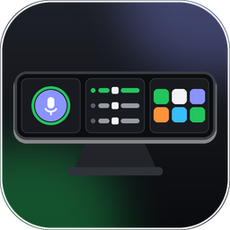
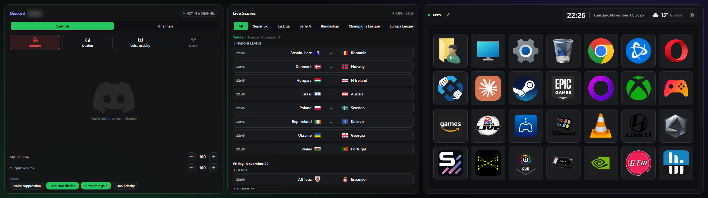

<p align="center">
  
</p>

<h1 align="center">TouchScreenEdgePanel</h1>

<p align="center">
  A lightweight, native Windows dashboard for the <b>Corsair Xeneon Edge</b> (2560×720) touch screen.<br>
  Discord voice controls · live football scores · app launcher · clock &amp; weather — in one small process.
</p>



---

### Why

Browser-based dashboards for the Xeneon Edge run a whole web engine (often a dozen-plus processes and around a gigabyte of RAM) just to draw a few widgets. TouchScreenEdgePanel is a single native WPF app:

| | TouchScreenEdgePanel |
|---|---|
| Memory | ~70–160 MB (depends on how many apps / leagues you add) |
| CPU when idle | ~0 % |
| GPU memory | 0 MB (CPU rendering, plenty for a mostly static dashboard) |
| Processes | 1 |
| Download | < 1 MB |

### Features

- **Discord** — mute, deafen, push-to-talk / voice activity, leave, mic &amp; output volume, noise suppression / echo cancellation / auto gain / QoS, who's in your channel (with a speaking ring), browse servers and join voice channels, and an **Open Discord** button when it's closed. Uses Discord's local RPC, so the Discord desktop app must be running.
- **Live scores** — a 5-day feed (yesterday → +3 days) plus each league's full current round: Süper Lig, LaLiga, Serie A, Bundesliga, Champions League, Europa League, Conference League, Nations League. Live matches refresh every 30 s; tap a match to open its summary in your browser.
- **App launcher** — apps from the Start menu (incl. Microsoft Store apps), any .exe / shortcut, folders, and system places (Recycle Bin, This PC, …). Custom pictures, drag-to-reorder in edit mode, and the grid auto-fits however many apps you add.
- **Clock, date &amp; weather** for any city (Open-Meteo).
- **Turkish and English** UI (follows Windows by default).
- **Game-friendly** — touching the panel doesn't steal focus from the game you're playing; it's hidden from Alt+Tab.

### Requirements

- Windows 10 / 11 (x64)
- [.NET 8 Desktop Runtime](https://dotnet.microsoft.com/download/dotnet/8.0) (x64)
- For the Discord widget: the Discord desktop app and your own (free) Discord application — see below

### Install

1. Download the latest zip from [Releases](https://github.com/dorukhanakar/TouchScreenEdgePanel/releases) and extract it anywhere.
2. Run `TouchScreenEdgePanel.exe`. It finds the 2560×720 screen by itself (you can pick another one in Settings).
3. Settings are behind the ⚙ in the top-right corner — turn on **Start with Windows** there.

### Discord setup (one time)

Discord only allows local voice control for an application you own:

1. Go to <https://discord.com/developers/applications> → **New Application**.
2. **OAuth2** page → copy the **Client ID** and **Client Secret**, and add `http://localhost` under **Redirects**.
3. In the panel: ⚙ → Discord → paste both → **Save and connect** → click **Authorize** in the window Discord opens.

The secret and token are stored encrypted for your Windows user only (DPAPI) in `%APPDATA%\TouchScreenEdgePanel\settings.json`.

### Adding apps

Tap the ✎ next to **APPS** for edit mode, then:
- **+ App** — searchable list of everything in your Start menu (or pick a file),
- **+ Folder** — any folder or drive,
- **+ System** — Recycle Bin, This PC, Downloads, Control Panel, …

You can also drag &amp; drop files or folders onto the panel. In edit mode: press and drag to reorder, ✕ to remove, tap an icon to give it your own picture.

### Build from source

```
dotnet publish TouchScreenEdgePanel.csproj -c Release -r win-x64 --self-contained false -p:PublishReadyToRun=true -o publish
```

Requires the .NET 8 SDK. The app icon is drawn by `tools/make_icon.py` (Pillow).

### Data sources &amp; notes

- Scores come from ESPN's public (unofficial, key-less) scoreboard JSON; it may change without notice.
- Weather and city search: [Open-Meteo](https://open-meteo.com/).
- This project is not affiliated with or endorsed by Corsair, Discord or ESPN. "Discord" and the Discord logo are trademarks of Discord Inc.

### Credits

- **Dorukhan Akar** ([@dorukhanakar](https://github.com/dorukhanakar)) — idea, design direction, testing on real hardware.
- **Claude Opus 5.5** by [Anthropic](https://www.anthropic.com/) — co-developer: wrote the code together with Dorukhan in [Claude Code](https://claude.com/claude-code).

### License

[PolyForm Noncommercial 1.0.0](LICENSE.md) — free to download, use, modify and share for **non-commercial** purposes. Commercial use (selling it, bundling it into a paid product, using it in a business) requires the author's permission.

<sub>Required Notice: Copyright 2026 Dorukhan Akar (https://github.com/dorukhanakar/TouchScreenEdgePanel)</sub>
